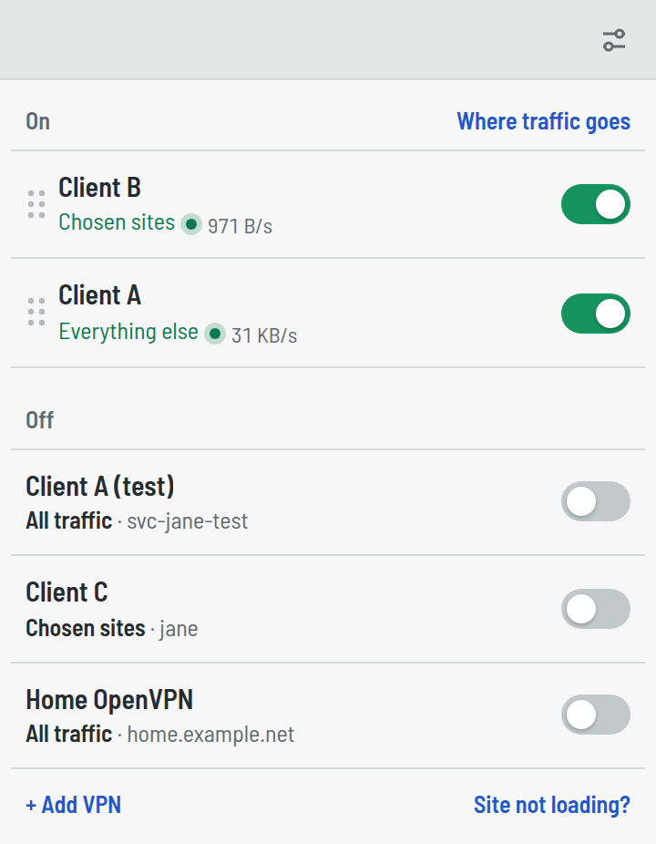
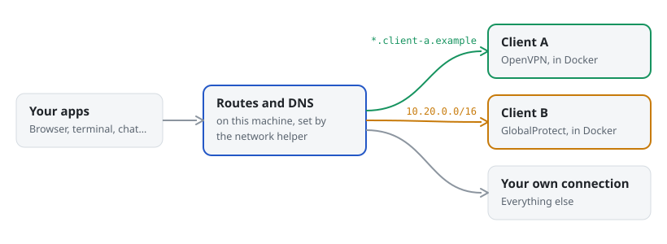

<p align="center">
  
</p>

<h1 align="center">Multi VPN Client</h1>

<p align="center">
  <strong>All your company VPNs, connected at the same time.</strong><br>
  Each one carries only its own addresses. Every app on your machine just works.
</p>

<p align="center">
  <a href="#start-it">Start it</a> ·
  <a href="#how-it-works">How it works</a> ·
  <a href="#something-wrong">Something wrong?</a> ·
  <a href="CONTRIBUTING.md">Contributing</a>
</p>

<p align="center">
  <picture>
    <source media="(prefers-color-scheme: dark)" srcset=".github/readme/window-dark.png">
    
  </picture>
</p>

> [!NOTE]
> **Alpha.** Expect rough edges, and settings that may need redoing between versions.

## What it does

For people who work with several clients or companies and need their corporate VPNs at the same time.

- **Several VPNs on at once.** When two cover the same address, the higher one in the list wins; a single address can be pinned to one VPN instead.
- **You choose what each one carries:** what its official app would, only the sites you pick, or all your traffic.
- **The official clients do the connecting:** OpenVPN, OpenConnect and snx-rs, each in its own container.
- **No proxy to set up.** Browsers, terminals and chat apps follow your machine's routes as they are.
- **macOS, Linux and Windows.**

## Supported VPNs

| VPN | Signs in with | Runs |
| --- | --- | --- |
| OpenVPN | Your provider's `.ovpn` file, plus a password if it asks for one | OpenVPN |
| Fortinet SSL VPN | Password, then a one-time code or a FortiToken push if the gateway asks | OpenConnect |
| GlobalProtect | Password, or an Estonian ID card in your card reader | OpenConnect |
| Check Point Remote Access | Password with Microsoft Authenticator (push or one-time code), or Entra ID sign-in in the browser | snx-rs |

## How it works

<picture>
  <source media="(prefers-color-scheme: dark)" srcset=".github/readme/how-it-works-dark.svg">
  
</picture>

Each VPN's client runs in its own Docker container. A small network helper points your machine's routes and DNS at the right container for each address, and everything else keeps using your own connection. A VPN that's off claims nothing.

It puts three things on your machine:

- **Docker containers,** one per VPN, so several can be connected without fighting over your network. The images are built on your machine the first time you connect, from Alpine or Debian packages, plus sing-box (and snx-rs for Check Point) at pinned versions whose checksums are verified.
- **The network helper,** a background service. You install it once from the app, which asks for your administrator password; connecting never asks again. It only takes requests from the app, and it uses [sing-box](https://github.com/SagerNet/sing-box) at a pinned version whose checksum is verified. On macOS it's a launchd daemon; on Linux it's a systemd service under its own user, allowed to change network settings and nothing else; on Windows it's a scheduled task that runs as SYSTEM, the least the network driver allows. Remove it in Settings → Network helper → Uninstall.
- **Saved passwords,** encrypted with your OS keychain. The app refuses to save them if no keychain is available.

## Start it

You need Docker installed and running, and Node 22 or newer.

```sh
npx multi-vpn-client
```

It downloads the app for your machine once per version, checks it against the checksums it was published with, and starts it. When a newer version is out, the window says so, and Settings → About updates it in place.

On first launch, start Docker and install the network helper from the setup card. Then add a VPN: type the address you'd use in its official app (the app works out the type), drop its `.ovpn` file on the window, or pick the type yourself.

To remove it, quit the app and run:

```sh
npx multi-vpn-client uninstall
```

It removes the network helper (it asks for your password), the downloaded versions and the VPN container images. It asks before deleting your VPNs and their saved passwords; by default they stay, for when you install it again.

## Something wrong?

```sh
npx multi-vpn-client triage
```

This starts Claude Code, Codex or Cursor Agent on your machine with this app's troubleshooting playbook. It asks what went wrong, then looks at Docker, the network helper, your VPN containers, your config and your routes. It checks whether a newer version already fixes the problem and drafts a GitHub issue with gateway addresses, usernames and IP addresses replaced by placeholders. It never opens your saved passwords, it asks before running anything that changes your machine, and it posts nothing until you say yes. Without any of them installed, it prints a folder with the playbook; start any coding agent there.

Keep the app open while you do this. A VPN's connection log is only on its page in the app and isn't saved to disk.

To write the report yourself, open a [bug report](https://github.com/atatter/multi-vpn-client/issues/new?template=bug.yml) or an [idea or question](https://github.com/atatter/multi-vpn-client/issues/new?template=idea.yml). Issues are public, so replace real gateway addresses, usernames and internal names with placeholders like `vpn.example.com`. Report security problems privately, as [SECURITY.md](SECURITY.md) describes.

## Working on it

To run it from source you need Docker, Node 24+ and pnpm:

```sh
pnpm install
pnpm dev
```

On Ubuntu, start it with `pnpm build:helper && pnpm build:card-bridge && pnpm --filter @repo/desktop exec electron-vite dev --noSandbox` instead, because AppArmor blocks Electron's sandbox in development builds.

Before a pull request, run `pnpm format`, `pnpm lint`, `pnpm typecheck` and `pnpm test`. Where code goes and how it's split is in [docs/code-structure.md](docs/code-structure.md).

To work on the window without Electron, Docker or VPNs, run `pnpm --filter @repo/desktop harness` and open the address it prints. It's the real window over a pretend main process; pick a situation with the address's ending: `#first`, `#daily`, `#overlap`, `#shared` or `#broke`.

How to propose a change is in [CONTRIBUTING.md](CONTRIBUTING.md).

## License

[MIT](LICENSE). Not affiliated with or endorsed by any VPN vendor.
